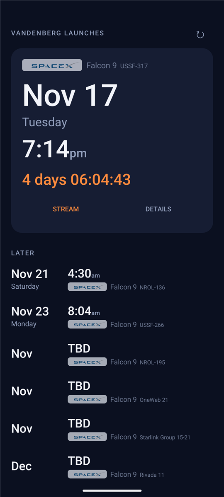
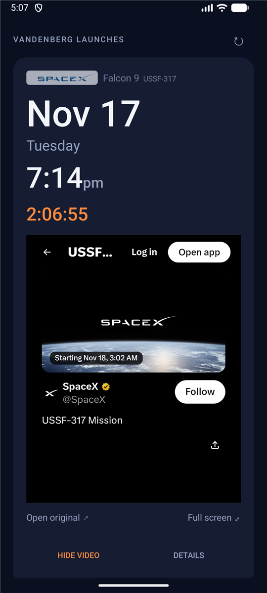
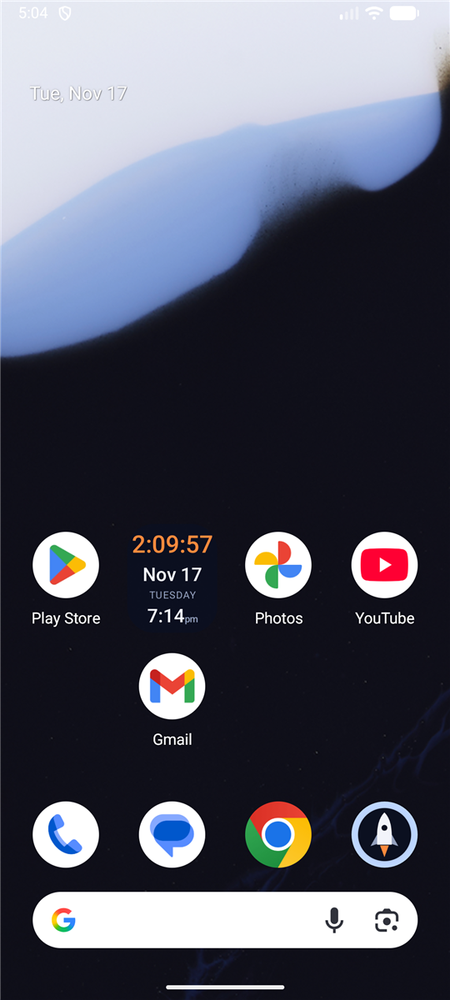

<h1> Vandi Launch</h1>

Android app and widget that tell you when the next rocket launches from Vandenberg. Nothing else.

<p>
  
  
  
</p>

- Next launch: date, time, countdown
- Stream plays in the app; full screen keeps the countdown on top
- Reminders 24 h, 1 h and 10 min before, plus a notice if the time changes
- 1x1 widget; the countdown moves to the top on launch day

## Install

Get the APK from the [latest release](https://github.com/NinjaKristo/VandiLaunch/releases/latest). Android 8 or newer.

## Data

[Launch Library 2](https://thespacedevs.com/llapi) by The Space Devs. Free, no key.

## Build

```
./gradlew assembleRelease
```

Android SDK 36, JDK 17+. Release signing reads `keystore.properties` (`storeFile`, `storePassword`, `keyAlias`, `keyPassword`); without it the debug key is used.
